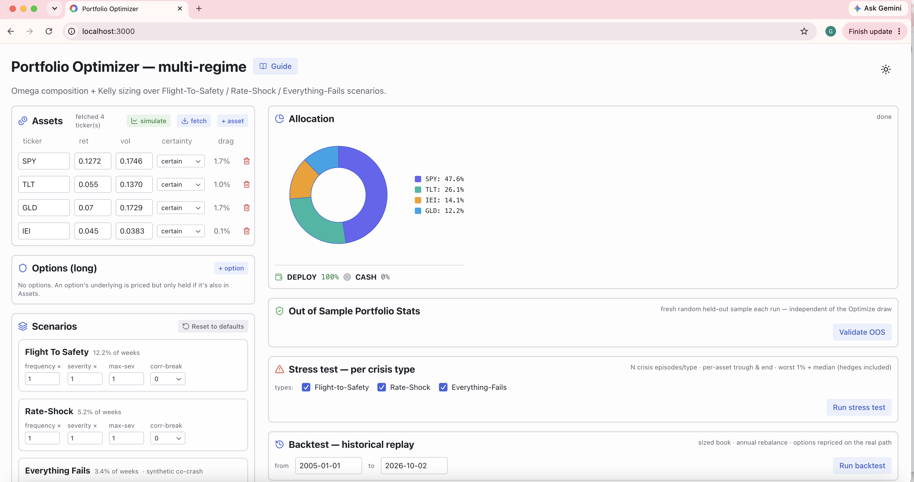

# Portfolio Optimizer

> Crisis-aware portfolio construction using CRRA / Omega utility over a
> generative multi-regime Monte Carlo engine.

**Status:** closed-source product — this repo is a **showcase** (overview,
screenshots, methodology). · **Live demo:** available on request · **Site:**
[portfoliodesigns.io](https://portfoliodesigns.io)

<!-- Add a screenshot/GIF to screenshots/ and update the path below. -->


## What it is

A portfolio optimizer that goes beyond mean–variance. Instead of relying on a
single historical covariance matrix, it drives optimization with a **generative
crisis engine** that simulates distinct market regimes with tunable severity,
frequency, and correlation breaks. You build a book from any assets, ETFs, and
protective options; optimize composition and sizing; validate out-of-sample;
stress-test against each crisis regime; and backtest the sized portfolio against
real history.

## Highlights

- **Three-regime generative crisis engine** — Flight-to-Safety, Rate-Shock, and
  Everything-Fails, with tunable onset, depth, duration, and hedge-failure
  correlation breaks.
- **Dual objectives** — CRRA log-utility (Kelly / fractional-Kelly) and the Omega
  ratio with CRRA sizing.
- **Two-stage solver** — efficient composition blend, then leverage-constrained
  sizing.
- **Arithmetic-return pinning** — assets locked to target arithmetic returns
  while preserving crisis impact on the tail.
- **Protective options** — long puts/calls with per-crisis strike and
  implied-vol tuning.
- **Out-of-sample validation** — reprices the fixed book on a fresh seed for
  unbiased stats.
- **Per-crisis stress tests** — worst-1% outcomes, weights, and risk contribution
  conditional on each regime.
- **Historical backtest** — equity curve with CAGR, max drawdown, and volatility.

## How it works

See **[docs/methodology.md](docs/methodology.md)** for the approach — the
scenario engine, the utility objectives, the two-stage solve, and how validation,
stress testing, and backtesting fit together.

## Architecture

```
Reflex web UI  ──▶  FastAPI compute service  ──▶  market data (returns, vol, SOFR)
  (inputs,            (scenario generation,
   dials, charts)      optimization, stats)
```

## Tech

`Reflex` · `FastAPI` · `NumPy` · `Plotly` · `Monte Carlo`

## Why it's closed-source

The calibrated regime engine, the sizing/composition solver, and the data
pipeline are the product's edge. Generic, textbook building blocks are
open-sourced separately — e.g. **[kelly-sizing](https://github.com/gregharris73/kelly-sizing)**.

---

© Greg Harris · documentation and media only. Not open-source software.
